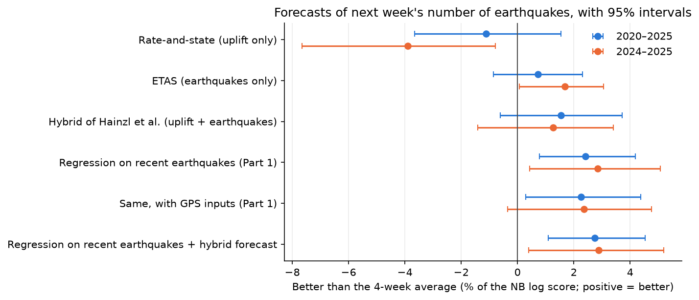
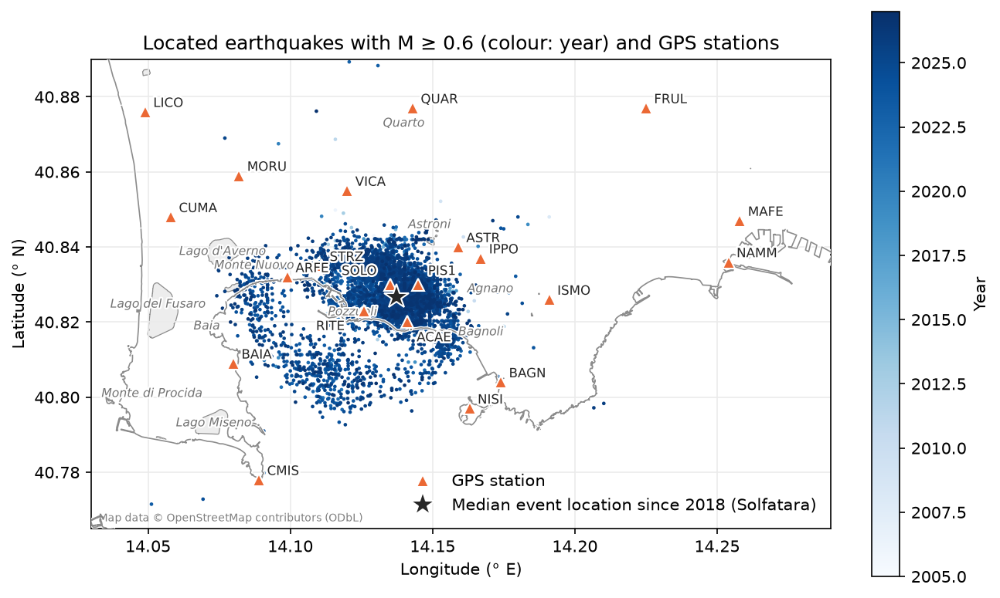
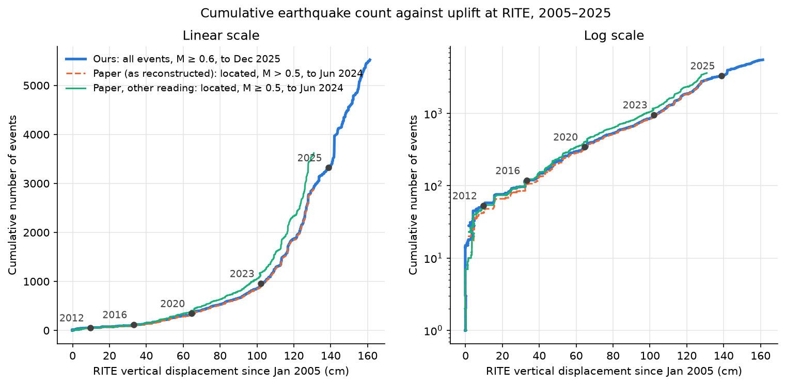
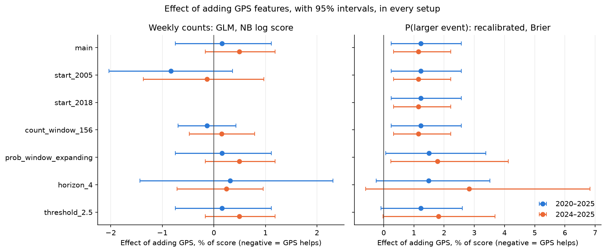
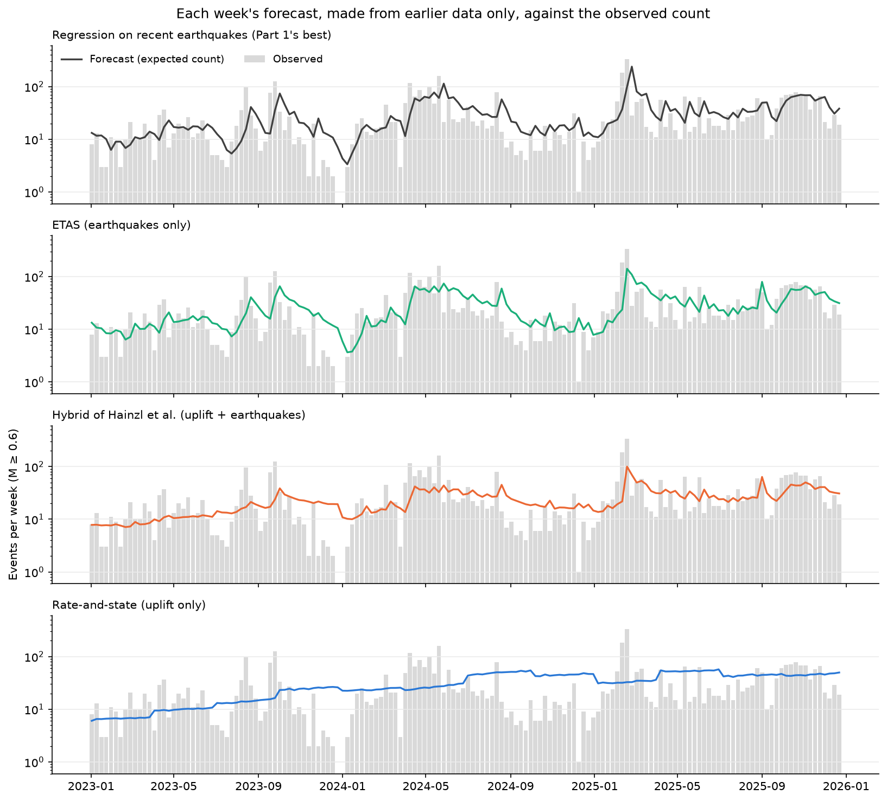
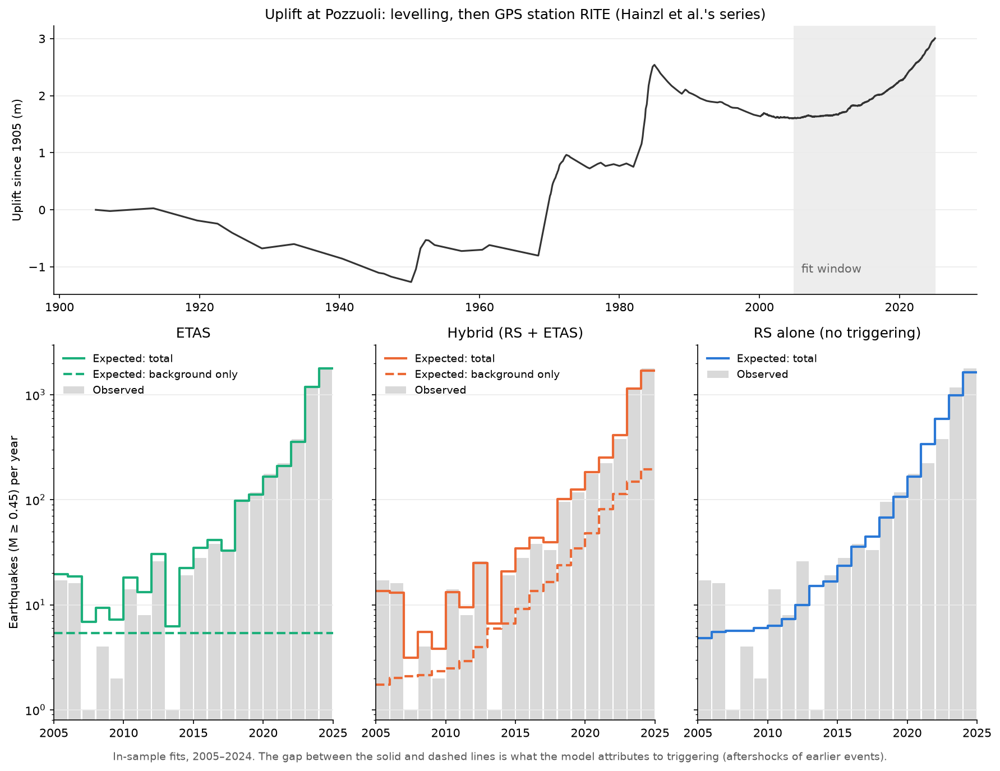

# Can ground uplift forecast earthquake rates? ML vs. physics-based models

Campi Flegrei, the volcanic caldera beneath Pozzuoli near Naples, is in a long period of unrest:
the ground has risen by about 1.6 m since 2005 and earthquakes have become far more frequent.
This project asks whether **GPS measurements of that uplift can help forecast how many
earthquakes will happen in the coming week, and how likely a larger one (magnitude 3 or more)
is.**

It forecasts rates and probabilities, not individual earthquakes, which cannot be predicted.
It is an exploratory project in machine learning, built on public data, with the code included
so the results can be checked and extended.

**Short answer:**

- **GPS uplift adds no measurable skill a week ahead,** whether it is an input to the
  machine-learning models or drives the background rate of a physics model.
- **A simple regression on recent earthquake counts matches or beats the physics models** (ETAS,
  and the uplift-driven hybrid of Hainzl et al. 2026) when each week is forecast from earlier
  data only. It is significantly better than ETAS over 2020–2025.
- **The hybrid's large advantage in hindsight disappears when forecasting.** Fitted to the
  authors' data for 2005 to early 2025 all at once, it explains the seismicity far better than ETAS
  (a difference in AIC of 155). Forecasting week by week, the two are within noise of each
  other, because the physics forecast is 97–98% predictable from the recent earthquake counts.



*Each model against a simple benchmark (next week like the average of the last four weeks),
forecasting each of the 312 weeks of 2020–2025 from earlier data only (blue: the whole period;
orange: 2024–2025 alone). Points right of the line are better than the benchmark; the bars are
95% intervals.*

**Disclaimer:** this is an informal research exercise, not a hazard forecast. For official information about Campi Flegrei, see the [INGV Vesuvius Observatory (INGV-OV)](https://www.ov.ingv.it/) and the Italian [Civil Protection Department](https://www.protezionecivile.gov.it/).

## The question, and where it comes from

A 2025 study ([Godano et al., arXiv 2503.20129](https://arxiv.org/abs/2503.20129)) showed that
the cumulative number of earthquakes at Campi Flegrei rises smoothly with the uplift at one GPS
station, and explained this with a simple epidemic model in which uplift loads the rock and
earthquakes trigger further earthquakes.

This project:

1. builds forecasting models that use the uplift at **many GPS stations** (the main station
   RITE, and combined rates from 10 others: 6 near the centre of uplift and 4 far from it),
   together with past earthquakes;
2. tests honestly whether the GPS information improves the forecasts;
3. compares these models with physics-based forecasts, including the uplift-driven model of
   Hainzl et al. (2026), and tests whether giving the physics forecast to the machine-learning
   model helps.

## Related work

- **Godano et al. (2025)**, the starting point above: the cumulative number of earthquakes as a
  function of the uplift at one GPS station.
- **Petrillo & Taroni (2025)** extend ETAS, the standard model of earthquakes triggering further
  earthquakes, with a background rate driven by the strain rate measured by GNSS (GPS), and find
  a better fit for 2013–2024 (a lower AIC).
- **Hainzl, Dahm & Tramelli (2026)** combine ETAS with a rate-and-state model in which the uplift
  since 1905 loads faults, and test weekly to monthly forecasts pseudo-prospectively. Their code
  and data are public; this project reuses them.
- **Iaccarino et al. (2025)** relate deformation rates and seismic moment to the magnitudes of
  the larger earthquakes in 20 sequences from 2015 to 2024.
- **Tan et al. (2025)** used machine learning to expand the 2022–2025 catalogue from about
  12,000 to more than 54,000 earthquakes. This project uses the standard catalogue.

What this project adds: an out-of-sample, week-by-week comparison of machine-learning and
physics-based forecasts, with and without the uplift, on the same 312 weeks and scores, in open
code.

## What the data show

The data are the earthquake catalogue of INGV's Vesuvius Observatory (34,535 events since 2005)
and daily GPS positions from 21 stations (2000–2025), all public (see [Credits](#credits)).



- **The earthquakes are tightly clustered** around the Solfatara crater, mostly 0.5–3.5 km deep.
  The ground rises most at station RITE on the Pozzuoli waterfront.
- **The forecasts count earthquakes of magnitude 0.6 or more** (6,161 events), which the
  network has recorded reliably since 2005; smaller ones were often missed before it grew.
- **Both uplift and earthquakes have accelerated:** the uplift from a few cm a year before 2011
  to 20–30 cm a year in pulses since 2023, the earthquakes doubling roughly every 1.5 years
  from 2018, with swarms on top (600 events in February 2025).
- **The 2025 study's relationship holds:** since 2012 the cumulative number of earthquakes has
  grown tenfold for every 73 cm of uplift (below). Week by week, though, bursts of uplift and
  bursts of earthquakes happen together: the uplift doesn't clearly lead.



## Method

- **What is forecast:** each week, the number of earthquakes of magnitude 0.6 or more, and the
  probability of at least one of magnitude 3 or more.
- **How forecasts are tested:** each of the 312 weeks of 2020–2025 is forecast from earlier data
  only, then compared with what happened; also for 2024–2025 alone, when activity changed least.
- **What is compared:** simple benchmarks; the 2025 study's model; Poisson regression and
  gradient-boosted trees (LightGBM) on recent earthquake counts, with and without GPS inputs;
  ETAS, a rate-and-state model driven by the uplift, and their hybrid (Hainzl et al. 2026),
  refitted every three months, each week's forecast the mean of 2,000 simulations; and the
  regression given a physics forecast as an extra input.
- **Scoring** rewards forecasts for being both accurate and honest about their uncertainty, with
  95% intervals on every comparison, so that chance differences aren't mistaken for real ones.

## Results

### GPS in the machine-learning models

The best machine-learning model is a regression on recent earthquake counts: 2.4% better than
the simple benchmark, a statistically significant gain. Adding the GPS inputs changed it by
+0.2% (interval −0.8% to +1.1%), no measurable effect, and made the forecast of a magnitude ≥ 3
earthquake slightly worse (+1.2%, interval +0.3% to +2.6%). The same holds in six variations of
the setup (other training periods, a 4-week horizon, a lower magnitude threshold), and the tests
could detect gains of about 1–3%, the size of the real gains the models make from earthquake
data.

**Why:** the slow part of the uplift signal (how far the ground has risen) tells the models the
same thing as the running total of earthquakes, which they already have. The fast part (how
quickly it is rising this week) is weak, noisy, and happens at the same time as the earthquake
bursts rather than before them.

<details>
<summary>Details: results table and the six variations</summary>

| Forecast | Best model | Effect of adding GPS |
|---|---|---|
| Earthquakes next week | Regression on recent earthquake counts: about 2.4% better than the simple benchmark (a real, statistically significant gain) | +0.2% worse (interval −0.8% to +1.1%): **no effect** |
| Chance of a magnitude ≥ 3 next week | Recent earthquake rate, allowing for clustering in swarms: 3–5% better than the recent frequency of such weeks, but **not significant** on the main score | +1.2% worse (interval +0.3% to +2.6%): **slightly harmful** |

The chart shows the effect of adding GPS in the main setup and in the variations that change
each model. Points left of the line would mean GPS helps; the bars show 95% intervals.



</details>

### Physics-based models

The headline chart at the top compares the physics models with the machine-learning ones.

<details>
<summary>Show the numbers</summary>

Better than the benchmark, as % of the score; 95% intervals in brackets; * marks differences
that are statistically significant.

| Model | 2020–2025 | 2024–2025 |
|---|---|---|
| Rate-and-state (uplift only) | −1.1% [−3.7, +1.5] | −3.9% [−7.6, −0.8]* |
| ETAS (earthquakes only) | +0.7% [−0.9, +2.3] | +1.7% [+0.1, +3.1]* |
| Hybrid of Hainzl et al. (uplift + earthquakes) | +1.6% [−0.6, +3.7] | +1.3% [−1.4, +3.4] |
| Regression on recent earthquakes | +2.4% [+0.8, +4.2]* | +2.8% [+0.4, +5.1]* |
| Same, with GPS inputs | +2.3% [+0.3, +4.4]* | +2.4% [−0.4, +4.8] |
| Regression on recent earthquakes + the hybrid's forecast | +2.7% [+1.1, +4.5]* | +2.9% [+0.4, +5.2]* |

</details>

- **Machine learning against physics:** the regression on recent earthquakes is at least as
  good as both physics models, and significantly better than ETAS over 2020–2025.
- **Does the uplift help the physics model?** Not measurably, a week ahead: the hybrid and ETAS
  are within noise of each other (0.8% apart over 2020–2025, 0.4% the other way in 2024–2025).
  The uplift alone (rate-and-state) is worse than the simple benchmark.
- **The physics forecast as an input:** adding the hybrid's forecast to the regression gives the
  best model overall, but only 0.3% better than the regression alone over 2020–2025, and no
  better in 2024–2025.
- **Larger earthquakes:** no physics-based or combined forecast beats the best simple forecast
  of the chance of a magnitude ≥ 3 next week.

Week by week, ETAS reacts to swarms much like the regression; the hybrid is smoother and was too
low in the busy weeks of 2024; rate-and-state alone follows only the slow trend:



The reason is the same as for GPS. The figure below shows the long view: the three physics
models fitted to 2005–2024 at once (Hainzl et al.'s data, magnitude 0.45 or more). ETAS has a
fixed background rate (dashed) and must explain all the growth by earthquakes triggering
earthquakes; the hybrid lets the uplift since 1905 (top) supply a growing background. That is
why it fits the 20 years better, as Hainzl et al. and Petrillo & Taroni found, and also why it
adds little a week ahead, when the recent earthquakes already show the current level.



<details>
<summary>Other findings</summary>

- **The 2025 study's model can be reproduced** (parameters 0.75 and 0.21, against the published
  0.76 and 0.2), but they depend on an assumption the data can't check, and it underestimates
  the earthquakes after May 2024.
- **Hainzl et al.'s model was reproduced from their code and data** (same likelihood;
  parameters within 0.5%, except the poorly constrained Omori c, within 2%).
- **Within-week aftershocks matter:** in the fitted physics models each earthquake triggers on
  average 0.8–1 further earthquakes, mostly within days, so a weekly physics forecast that ignores the week's own
  aftershocks is 2–3 times too low.
- **Honest uncertainty matters:** simple forecasts' "80% ranges" contained the true count only
  45% of the time; allowing for swarms fixes this (86–90%).

</details>

### Limitations

Forecasts were tested up to four weeks ahead only (one week for the physics models). The
physics models are fitted to our catalogue at magnitude 0.6 rather than the published 0.45, and
their fits are poorly determined before 2022, when there were few earthquakes. The catalogue's
magnitudes are duration magnitudes, which can differ by a few tenths from other scales; only 43
test weeks contained an earthquake of magnitude 3 or more, so those results are uncertain; and
the GPS data end in December 2025. Uplift may still matter for longer horizons (months to
years), for other questions such as how large a swarm can grow, or with other deformation data
such as satellite radar (InSAR).

Neural point-process models were not tried. In a recent benchmark on California catalogues with
18,000–128,000 training earthquakes (EarthquakeNPP; Stockman, Lawson & Werner 2024), none of the
five tested outperformed ETAS, and they work from the catalogue alone, without the magnitudes
ETAS uses. Here even LightGBM loses to the regression, and the physics forecast adds almost
nothing beyond recent counts, so the limit seems to be the information in the data rather than
model capacity. A larger catalogue, such as that of Tan et al. (2025), would be the place to try
them.

## Notebooks

The details, code and many more plots are in the notebooks, which are meant to be read in
order:

| Notebook | Contents |
|---|---|
| [`01_completeness`](notebooks/01_completeness.ipynb) | Which earthquakes are reliably recorded; the b-value over time |
| [`02_explore`](notebooks/02_explore.ipynb) | Earthquake rate, uplift and their relationship; larger events; map |
| [`03_baselines`](notebooks/03_baselines.ipynb) | Simple benchmarks; the 2025 study's model reproduced |
| [`04_models`](notebooks/04_models.ipynb) | Regression and LightGBM with and without GPS; explanations (SHAP) |
| [`05_evaluation`](notebooks/05_evaluation.ipynb) | Forecast uncertainty, detectable effects, six variations |
| [`06_physics_baselines`](notebooks/06_physics_baselines.ipynb) | ETAS, rate-and-state and the hybrid: checked against the authors' code, then weekly forecasts |
| [`07_ml_vs_physics`](notebooks/07_ml_vs_physics.ipynb) | The physics forecast as an input to the machine-learning models |

## Reproducing the results

### Setup

With conda (recommended):

```bash
conda env create -f environment.yml
conda activate flegrei-seismicity
```

Without conda, use Python 3.14, then `pip install -r requirements.txt` and `pip install -e .`
(the second command makes the project's own code in `src/` importable). On macOS, LightGBM also
needs OpenMP (`brew install libomp`).

### Data

Raw data (about 40 MB) lives in `data/raw/` and is not committed. Download it, then build the
cleaned tables in `data/processed/`:

```bash
python scripts/download_data.py
python scripts/process_data.py
```

| Folder in `data/raw/` | Contents |
|---|---|
| `catalogue/` | INGV-OV GOSSIP earthquake catalogue, one CSV per year from 2005 |
| `gps_21_stations/` | Daily GPS positions of 21 stations, 2000–2025 |
| `gps_rite/` | Daily and weekly vertical GPS positions at station RITE, 2000–2024 |
| `hainzl/` | Code and data of Hainzl, Dahm & Tramelli (2026), including the uplift since 1905 |
| `osm/` | Coastline, lakes and place names from OpenStreetMap, for maps |

Each folder gets a `SOURCES.json` recording every file's URL, download time and checksum (Zenodo
files are also checked against Zenodo's). The catalogue is updated continuously, so a later
download will contain more events. GPS station coordinates are in
`data/reference/gps_stations.csv`.

Then run the notebooks in order. They cache their forecasts in `data/processed/forecasts/`
(the physics forecasts take about 15 minutes the first time); delete that folder after changing
model code.

## References

- Godano, C., Convertito, V., Tramelli, A., & Petrillo, G. (2025). How ground deformation
  influences earthquake occurrence during the ongoing unrest at Campi Flegrei (2005–present).
  arXiv:2503.20129. https://arxiv.org/abs/2503.20129
- Petrillo, G., & Taroni, M. (2025). Adding strain rate information into a short-term
  seismicity model improves forecasting performances: the case of Campi Flegrei, Italy.
  *Seismica*, 4(2). https://doi.org/10.26443/seismica.v4i2.1908
- Hainzl, S., Dahm, T., & Tramelli, A. (2026). A deformation-driven earthquake interaction model
  for seismicity at Campi Flegrei. *Communications Earth & Environment*, 7, 244.
  https://doi.org/10.1038/s43247-026-03296-3
- Iaccarino, A. G., Picozzi, M., De Landro, G., & Spallarossa, D. (2025). Preparatory phase of
  major earthquakes during Campi Flegrei unrest (2020–2024). *Journal of Geophysical Research:
  Solid Earth*, 130, e2025JB031777. https://doi.org/10.1029/2025JB031777
- Tan, X., Tramelli, A., Gammaldi, S., Beroza, G. C., Ellsworth, W. L., & Marzocchi, W. (2025).
  A clearer view of the current phase of unrest at Campi Flegrei caldera. *Science*, 390,
  70–75. https://doi.org/10.1126/science.adw9038
- Stockman, S., Lawson, D., & Werner, M. (2024). EarthquakeNPP: A benchmark for earthquake
  forecasting with neural point processes. arXiv:2410.08226. https://arxiv.org/abs/2410.08226


## Credits

The earthquake and GPS data, and Hainzl et al.'s code and data, are published under
[CC BY 4.0](https://creativecommons.org/licenses/by/4.0/).

- Ricciolino, P., Lo Bascio, D., & Esposito, R. (2024). *GOSSIP - Database Sismologico Pubblico
  INGV-Osservatorio Vesuviano*. Istituto Nazionale di Geofisica e Vulcanologia (INGV).
  https://doi.org/10.13127/GOSSIP
- De Martino, P., Dolce, M., Brandi, G., Iorio, A., Scarpato, G., & Tammaro, U. (2026).
  *Continuous GPS time series of East, North and Up ground displacements in the Campi Flegrei
  caldera, Italy (2000-2025)* [Dataset]. Zenodo. https://doi.org/10.5281/zenodo.22259337
- De Martino, P., Dolce, M., Brandi, G., Iorio, A., Romeo, A., Tammaro, U., & Scarpato, G.
  (2025). *Vertical displacement at Campi Flegrei: daily and weekly GNSS time series from station
  RITE (2000-2024)* [Dataset]. Zenodo. https://doi.org/10.5281/zenodo.17132077
- De Martino, P., Dolce, M., Brandi, G., Scarpato, G., & Tammaro, U. (2021). The Ground
  Deformation History of the Neapolitan Volcanic Area (Campi Flegrei Caldera, Somma–Vesuvius
  Volcano, and Ischia Island) from 20 Years of Continuous GPS Observations (2000–2019).
  *Remote Sensing*, 13(14), 2725. https://doi.org/10.3390/rs13142725 (also the source of the
  station coordinates, from its Table 1).
- Hainzl, S. (2026). *Codes and files related to Hainzl, Dahm & Tramelli (2026)* [Dataset].
  Zenodo. https://doi.org/10.5281/zenodo.18413119
- Map features: © [OpenStreetMap](https://www.openstreetmap.org/copyright) contributors,
  available under the [Open Database Licence (ODbL)](https://opendatacommons.org/licenses/odbl/).

## Licence

The code is released under the [MIT licence](LICENSE). `src/physics.py` is adapted from
Hainzl (2026), Zenodo [doi:10.5281/zenodo.18413119](https://doi.org/10.5281/zenodo.18413119),
which is under [CC BY 4.0](https://creativecommons.org/licenses/by/4.0/); the attribution is
kept in the file's header. The data keep their own licences, listed above.

## How this was built

Built with Claude Code (Anthropic) as a learning project in machine learning. Patrick Bolton
directed the work and reviewed every step.
