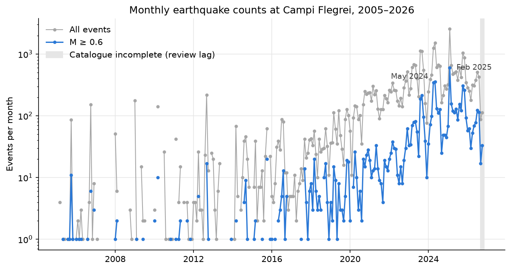

# Campi Flegrei: can ground uplift forecast earthquake rates?

Work in progress. A learning project that asks whether GPS ground deformation at Campi Flegrei
(uplift, uplift rate and acceleration across 21 stations) can forecast the **rate** of earthquakes
and the **probability of larger events** (M ≥ 3) in the following days and weeks.

This project forecasts rates and probabilities. It does not predict individual earthquakes.

## Preliminary results (exploratory, October 2026)

No forecasting models yet: these are first observations from cleaning and exploring the data
(catalogue downloaded 22 Oct 2026). Details, code and caveats are in
[`notebooks/01_completeness.ipynb`](notebooks/01_completeness.ipynb) and
[`notebooks/02_explore.ipynb`](notebooks/02_explore.ipynb).


**Where.** The earthquakes are tightly clustered around Solfatara, under the town of Pozzuoli and
the Gulf of Pozzuoli, mostly 0.5–3.5 km deep. Each year, half the events lie within about 1 km
of the centre; the outer edge has grown from about 2 km to about 3 km since 2023. The ground rises most
at station RITE on the Pozzuoli waterfront, about 1 km south-west of the seismic centre, and
uplift falls off with distance (from over 1 m since 2018 near the centre to 1–2 cm or less at
stations 9–10 km away).

**Which events count.** The catalogue (34,535 events since 2005) is only complete above a
magnitude of about Md 0.6 before 2017 and 0.5 after, because the seismic network grew. We count
events with M ≥ 0.6 (6,161 events), so that rates are comparable across the years. Small
magnitudes take only a few discrete values (Md comes from signal duration, apparently measured
in whole seconds), which limits how low the completeness magnitude can be measured.



**How fast.** Events with M ≥ 0.6 were rare until about 2016 (most months had none or one). Since
2017–2018 the rate has climbed steadily, from about 7 a month in 2018 to about 180 a month in
2025, roughly doubling every 1.5 years, with large swarms on top (February 2025: 600 events at
M ≥ 0.6 in one month). 2026 so far is quieter than 2025.

**Uplift.** RITE has risen about 160 cm since January 2005, almost all after 2011. Since about
2013 the uplift has grown roughly exponentially (doubling about every 4 years, slowly
lengthening), and the uplift rate has reached 20–30 cm/year in pulses since 2023.


**Earthquakes against uplift.** As in the paper we build on (arXiv 2503.20129), the cumulative
number of earthquakes rises smoothly with uplift: since 2012 it grows tenfold for every 73 cm of
uplift at RITE. Our event set (all events with M ≥ 0.6) gives almost the same curve as the
paper's (located events with M > 0.5). As a consequence, the same amount of uplift now produces
far more earthquakes than ten years ago: events per cm of uplift grew about 36-fold from 2014 to
2025, in step with the cumulative count.

**Week by week.** After removing the long-term trend, pulses of uplift and bursts of seismicity
happen at the same time, with at most a week's lead for the uplift. The uplift rate measured up
to the end of a week correlates only weakly with the next week's count (0.17), and not at all
four weeks ahead. So any forecasting skill from GPS is likely to be modest; the models in the
next phase will be compared against simple baselines that use past seismicity alone.

**Larger events.** There have been 91 events with M ≥ 3, all since December 2019 and most since
2023, falling in 51 of 399 weeks. They are more common than a single Gutenberg–Richter law fitted
to small events predicts, and the Gutenberg–Richter b-value has fallen from about 1.05 to about
0.8 during 2022–2023.

## Setup

With conda (recommended):

```bash
conda env create -f environment.yml
conda activate flegrei-seismicity
```

Without conda, use Python 3.14, then `pip install -r requirements.txt` and `pip install -e .`
(the second command makes the project's own code in `src/` importable). On macOS, LightGBM also
needs OpenMP (`brew install libomp`).

## Data

Raw data lives in `data/raw/` and is not committed. To download it (about 10 MB):

```bash
python scripts/download_data.py
```

This fetches:

| Folder in `data/raw/` | Contents |
|---|---|
| `catalogue/` | INGV-OV GOSSIP earthquake catalogue for Campi Flegrei, one CSV per year from 2005 |
| `gps_21_stations/` | Daily East/North/Up GPS displacements for 21 stations, 2000–2025 |
| `gps_rite/` | Daily and weekly vertical GPS displacement at station RITE, 2000–2024 |
| `osm/` | Coastline, lakes and place names from OpenStreetMap, for maps |

Each folder gets a `SOURCES.json` with every file's URL, download time (UTC) and SHA-256
checksum. The GPS files are also checked against the MD5 checksums published by Zenodo. The
catalogue is updated continuously, so a later download will contain more (and revised) events.

GPS station coordinates are in `data/reference/gps_stations.csv` (committed; see the README
there). To build the cleaned tables in `data/processed/` used by the notebooks:

```bash
python scripts/process_data.py
```

### Credits

The earthquake and GPS data are published under
[CC BY 4.0](https://creativecommons.org/licenses/by/4.0/).

- Ricciolino, P., Lo Bascio, D., & Esposito, R. (2024). *GOSSIP - Database Sismologico Pubblico
  INGV-Osservatorio Vesuviano*. Istituto Nazionale di Geofisica e Vulcanologia (INGV).
  https://doi.org/10.13127/GOSSIP
- De Martino, P., Dolce, M., Brandi, G., Iorio, A., Scarpato, G., & Tammaro, U. (2026).
  *Continuous GPS time series of East, North and Up ground displacements in the Campi Flegrei
  caldera, Italy (2000-2025)* [Dataset]. Zenodo. https://doi.org/10.5281/zenodo.22259337
- De Martino, P., Dolce, M., Brandi, G., Iorio, A., Romeo, A., Tammaro, U., & Scarpato, G.
  (2025). *Vertical displacement at Campi Flegrei: daily and weekly GNSS time series from station
  RITE (2000-2024)* [Dataset]. Zenodo. https://doi.org/10.5281/zenodo.17132077
- De Martino, P., Dolce, M., Brandi, G., Scarpato, G., & Tammaro, U. (2021). The Ground
  Deformation History of the Neapolitan Volcanic Area (Campi Flegrei Caldera, Somma–Vesuvius
  Volcano, and Ischia Island) from 20 Years of Continuous GPS Observations (2000–2019).
  *Remote Sensing*, 13(14), 2725. https://doi.org/10.3390/rs13142725 (also the source of the
  station coordinates, from its Table 1).
- Map features: © [OpenStreetMap](https://www.openstreetmap.org/copyright) contributors,
  available under the [Open Database Licence (ODbL)](https://opendatacommons.org/licenses/odbl/).
